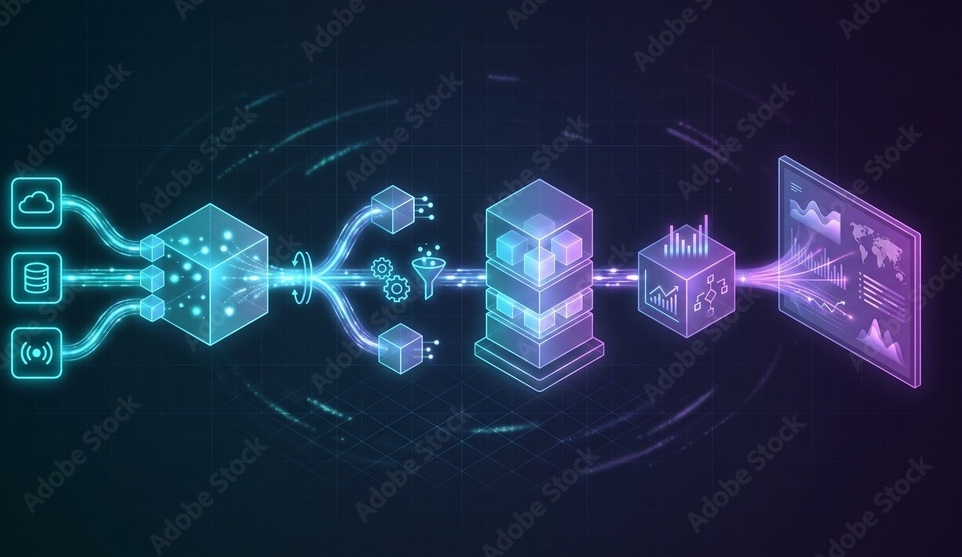

# Hi, I'm Raju Patel 👋

### Data Engineer | Azure Databricks | Microsoft Fabric | PySpark | Python | SQL

I'm a Data Engineer focused on building reliable, scalable data solutions and end-to-end data pipelines that transform raw data into meaningful business insights.

My experience and hands-on projects cover data ingestion, ETL/ELT development, incremental data processing, dimensional modelling, workflow orchestration and analytics-ready data solutions.

I'm particularly interested in modern data engineering, cloud data platforms, data architecture and building solutions that support data-driven decision-making.

---

## 🛠️ Tech Stack

<b>📄 Full Technical Skills</b>

**Programming & Querying:** Python · PySpark · SQL · Databricks SQL

**Data Engineering:** ETL / ELT Pipelines · Incremental Data Loading · Delta Lake · SCD Type 1 · Delta Lake MERGE Operations · Medallion Architecture (Bronze, Silver, Gold)

**Platforms & Cloud:** Azure Databricks · Microsoft Fabric · Microsoft Azure · Azure Cosmos DB · Amazon S3 · Unity Catalog · SQL Server

**Data Modelling & Analytics:** Star Schema · Fact and Dimension Tables · Dimensional Modelling · Historical Snapshots · Power BI

**Orchestration & DevOps:** Databricks Jobs · Declarative Automation Bundles · Workflow Orchestration · Git · CI/CD

---

## 🚀 Data Engineering Projects

### 📦 1. [Retail Data Platform](https://github.com/rajupatel2386/retail-data-platform)
**`Azure Databricks · PySpark · Delta Lake · Azure Cosmos DB · SQL Server · Amazon S3 · Git`**

- Designed a multi-source data platform integrating data from Azure Cosmos DB, SQL Server and Amazon S3.
- Implemented a Bronze–Silver–Gold Medallion Architecture using Delta Lake.
- Built configuration-driven PySpark ETL pipelines.
- Implemented SCD Type 1 updates using Delta Lake MERGE operations.
- Developed analytics-ready fact and dimension tables following dimensional modelling principles.
- Applied Git-based CI/CD practices and managed secrets through Databricks Scopes.

### 🎓 2. [Education Analytics ELT Platform](https://github.com/rajupatel2386/education-analytics)
**`Azure Databricks · PySpark · Databricks SQL · Unity Catalog · Google Sheets`**

- Built an ELT pipeline to ingest education academy data from Google Sheets, covering students, batches, classes, assignments and attendance.
- Developed an analytics-ready data model within Unity Catalog.
- Implemented dimensional modelling using Databricks SQL.
- Orchestrated daily pipeline execution through a dependency-aware Databricks Job.
- Used a Declarative Automation Bundle to deploy the workflow.

### 👔 3. [Workforce Analytics Platform](https://github.com/rajupatel2386/workforce-analytics)
**`Azure Databricks · PySpark · Delta Lake · SQL · Power BI`**

- Built a data pipeline to process workforce shift, operational work and shrinkage data.
- Implemented an initial full load followed by incremental delta-file processing.
- Created historical daily snapshots in Delta tables to preserve changes over time.
- Developed Gold-layer fact and dimension tables for analytical reporting.
- Connected curated datasets to Power BI to support workforce analysis and historical reporting.
- Prepared workforce measures including utilisation and sickness percentage.

---

## 💼 Professional Experience

| Role | Company | Period |
| --- | --- | --- |
| Data Engineer | **Quantix IT** · England, UK | May 2025 – Present |
| Software Developer | Viva Software Solutions Pvt. Ltd. | Jan 2024 – Jan 2025 |
| Frontend Developer | Josho IT Solution Company | Dec 2020 – Apr 2021 |

**Data Engineer — Quantix IT** · *May 2025 – Present | England, United Kingdom*

Working with data engineering solutions involving:
- End-to-end ETL/ELT pipelines and multi-source data integration.
- Medallion Architecture and Delta Lake.
- Incremental data processing and dimensional modelling.
- Databricks Jobs, workflow orchestration and Git-based CI/CD.
- Power BI reporting and analytics-ready datasets.

**Software Developer — Viva Software Solutions Pvt. Ltd.** · *Jan 2024 – Jan 2025*

- Developed and maintained 7 production websites including vivacollege.org, vivaapplied.org, vivaarch.org, and vivapharmacy.org, serving thousands of users with 99.9% uptime.
- Engineered full-stack solutions using C#, ASP.NET, JavaScript, and SQL, implementing responsive frontend interfaces and robust backend architectures.
- Managed end-to-end web hosting operations and server infrastructure, optimizing load times by 30% through efficient resource allocation and caching strategies.
- Designed and optimized SQL databases ensuring data integrity, implementing normalization and indexing strategies that improved query performance by 40%
- Collaborated with cross-functional teams to gather requirements, debug critical issues, and deploy scalable solutions following agile methodologies

**Frontend Developer — Josho IT Solution Company** · *Dec 2020 – Apr 2021*

- Created responsive frontend web pages using HTML5, CSS3, JavaScript, and jQuery, ensuring cross-browser compatibility and mobile responsiveness.
- Maintained and enhanced existing websites by debugging code, improving UI/UX elements, and implementing new features based on client feedback.
- Contributed to 25% improvement in user experience metrics through optimized page layouts and interactive components.

---

## 🎓 Education

- **Master's Degree in Data Science** — Coventry University *(Jan 2025 – Jan 2026)*
- **Bachelor of Science in Information Technology (BSc IT)** — University of Mumbai *(Dec 2020 – Mar 2024)*
- **Viva College** — Intermediate (12th)

---

## 💡 Professional Interests

`Modern Data Engineering` `Cloud Data Platforms` `Scalable ETL/ELT Pipelines` `Data Warehousing & Dimensional Modelling` `Incremental Data Processing` `Data Architecture` `Business Intelligence & Analytics`

---

## 📫 Connect With Me

---

---

